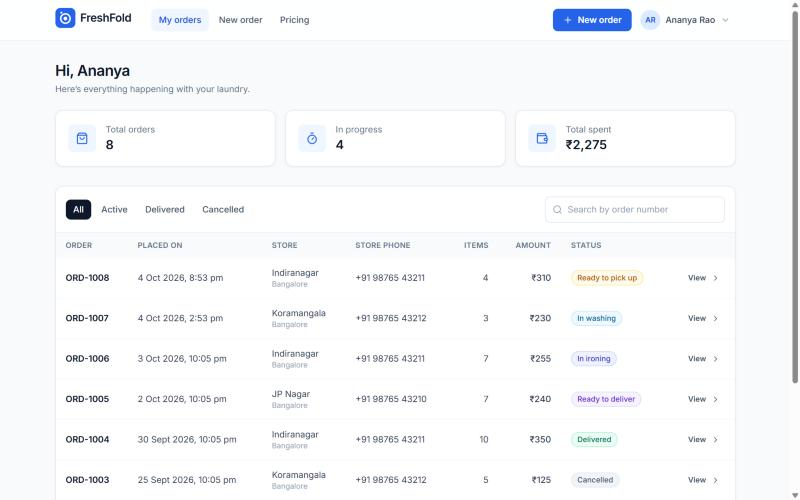
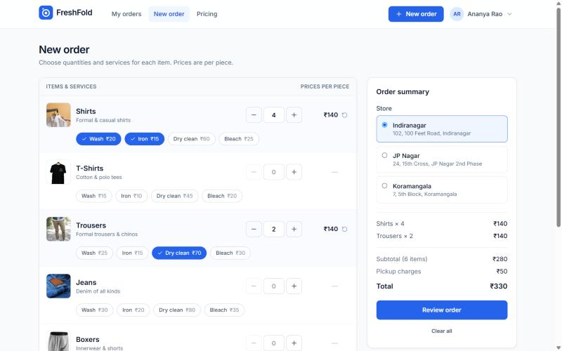
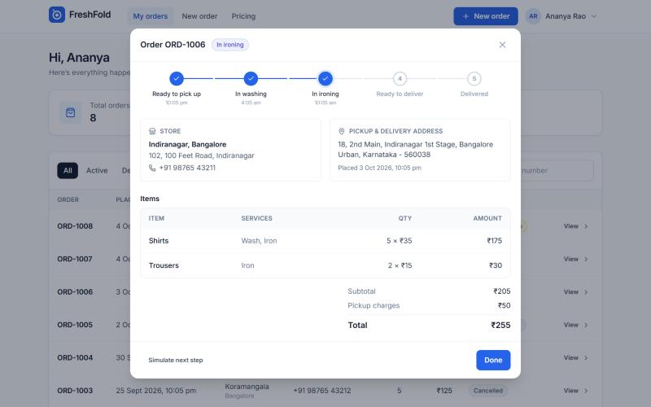
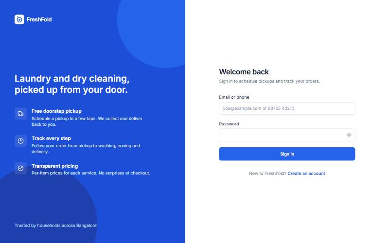
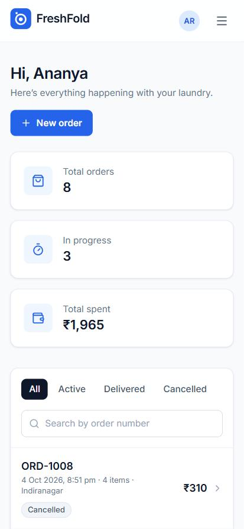

# FreshFold: doorstep laundry ordering

A full-stack laundry service app where customers sign up, build an order item by item (wash, iron, dry clean, bleach), choose a store, and follow the order from pickup to delivery.

**Stack:** React 18 · TypeScript · Vite · Tailwind CSS · TanStack Query · Node.js · Express · MongoDB (Mongoose) · Zod · JWT



| New order | Order details & tracking |
|---|---|
|  |  |

| Sign in | Mobile |
|---|---|
|  |  |

## Features

**Customers**
- Register with address details and sign in with **email or phone**
- Build an order per item: quantity stepper, pick any combination of services, live per-line and total pricing
- Choose a pickup store, review the order and place it
- Orders dashboard: stats (total orders, in progress, total spent), status filters, search by order number
- Order details with a **status timeline**: Ready to pick up → In washing → In ironing → Ready to deliver → Delivered
- Cancel an order (with confirmation) until it has been picked up
- Pricing page and profile page; fully responsive with a sticky checkout bar on mobile

**Engineering**
- **Server-side pricing**: the client sends only products, quantities and services; totals are always computed on the server from the catalog
- **Ownership checks** on every order route: users can only see and act on their own orders
- **Atomic cancellation** (`findOneAndUpdate` with a status guard) so an order can't be cancelled after pickup, even under concurrent requests
- Sequential, readable order numbers (`ORD-1001`, `ORD-1002`, …) from an atomic counter
- JWT auth with expiry, bcrypt password hashing, generic login errors (no account enumeration)
- Request validation with Zod, with field-level errors shown inline in the UI
- Central error handling with consistent JSON errors (400/401/404/409)
- Catalog and stores auto-seed on first boot; one-command demo data
- API integration tests (Node test runner + Supertest)

## Getting started

Requires **Node.js 20+** and **MongoDB** running locally (or a MongoDB Atlas URL).

```bash
npm run setup        # installs root, api and web dependencies
npm run seed:demo    # optional: demo account with 8 orders in every status
npm run dev          # API on :4000, web app on http://localhost:5175
```

Demo account (created by `seed:demo`): **demo@freshfold.dev** / **FreshFold@2026**

To configure the API, copy `api/.env.example` to `api/.env` and adjust as needed. Defaults work out of the box for local development.

```bash
npm test             # runs the API test suite against a local test database
```

## Project structure

```
api/                      Express + MongoDB API
  src/app.js              Express app (CORS, JSON, routes, error handling)
  src/routes.js           Auth, catalog and order endpoints
  src/models.js           User, Product, Store, Order, Counter schemas
  src/pricing.js          Server-side order pricing
  src/catalog.js          Default products and stores (auto-seeded)
  src/seed-demo.js        Demo account + order history
  tests/api.test.js       Integration tests
web/                      React + TypeScript app
  src/pages/              Login, Register, Orders, NewOrder, Pricing, Profile
  src/components/         Layouts, OrderDetails (timeline), StatusBadge, UI primitives
  src/lib/                API client, auth context, formatting, types
```

## API

| Method | Endpoint | Description |
|---|---|---|
| POST | `/api/auth/register` | Create an account, returns a token |
| POST | `/api/auth/login` | Sign in with email or phone |
| GET | `/api/auth/me` | Current user |
| GET | `/api/products` | Catalog with per-service prices and pickup charge |
| GET | `/api/stores` | Pickup stores |
| GET | `/api/orders?status=&q=` | My orders, filter by `active` / `delivered` / `cancelled`, search by number |
| GET | `/api/orders/stats` | Totals for the dashboard |
| GET | `/api/orders/:orderNumber` | Order details |
| POST | `/api/orders` | Place an order (priced on the server) |
| POST | `/api/orders/:orderNumber/cancel` | Cancel before pickup |
| POST | `/api/orders/:orderNumber/advance` | Demo mode only: move an order to its next status |

All order routes require `Authorization: Bearer <token>`.

## Credits

Inspired by a team project at 10x Academy by Aayu Agrawal, Giridhar and Chandan ([original repo](https://github.com/giridhar0025/10x-laundry-project)). This repository is a ground-up rewrite by Rahul Taritla: new UI, server-side pricing, auth and ownership checks, order tracking, store selection, dashboard, tests and demo data.
